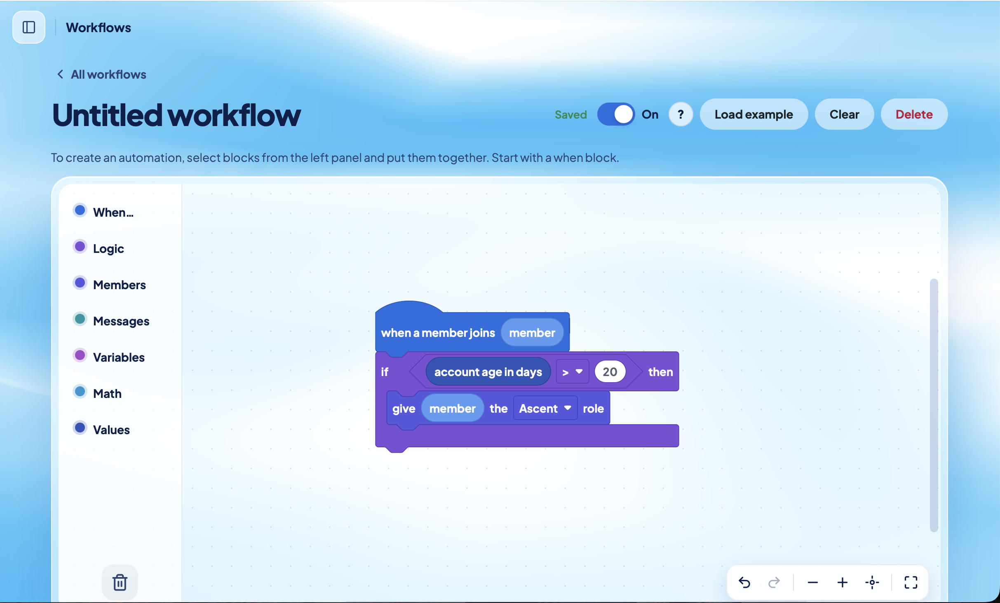

We are pleased to announce the newest module to the Ascent Verify system: Workflows.

Have you ever wanted a quick and custom automation for your server, like when a player joins the server, send a welcome message or more complex things like custom commands that your server needs. Now, with Ascent Workflows, you can do this!

The block editor is a great way for beginners to make automations that they wouldn't be able to otherwise.

This is available for Public Beta today. To access it simply go to our website: [https://ascentverify.xyz](https://ascentverify.xyz) and log into your account. From there select **My Servers > Workflows.** The first time you open the page it will take you through a tour to learn more about how to use it!  We are excited to see all of our community's varied uses and are excited for your feedback. As always, if you notice something, please reach out via support tickets!
